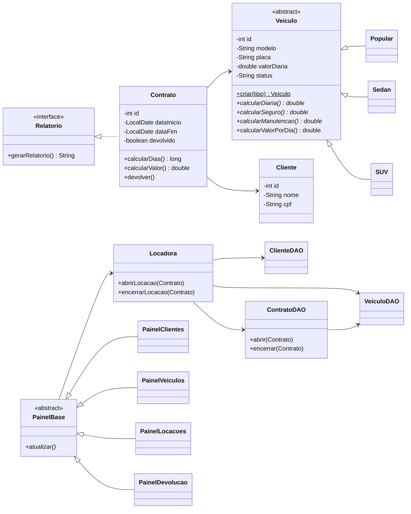

# Rota Segura - Sistema de Locação (TP2)

**Aluno:** Matheus Yuri Sadamatsu Rodrigues  
**RA:** 1301392611037

## 1. Descrição

O Rota Segura é um sistema de locação de veículos desenvolvido em Java com
Programação Orientada a Objetos.

Na **Parte 1**, o sistema rodava no console e guardava os dados em memória.
Na **Parte 2** (este TP), ele evoluiu para:

- uma **interface gráfica (GUI)** em Java Swing, com abas para Clientes,
  Veículos, Locações e Devolução;
- **persistência em banco de dados relacional (MySQL)**, usando o padrão
  **DAO (Data Access Object)**;
- **arquitetura em camadas**: Visão (`gui`), Regras de Negócio (`modelo` e
  `servico`) e Persistência (`dao`).

O atendente pode cadastrar, editar, remover e listar clientes e veículos,
abrir locações e encerrar contratos com o cálculo final feito de forma
polimórfica para cada categoria de veículo.

## 2. Requisitos de ambiente

| Item | Versão usada |
|---|---|
| Java (JDK) | 21 |
| IDE | Eclipse |
| Banco de dados | MySQL do XAMPP (MariaDB), porta 3307 |
| Driver JDBC | MySQL Connector/J (arquivo `.jar`) |

O Swing já vem no JDK: não é preciso instalar nada para as telas.

## 3. Estrutura do projeto

```text
RotaSegura
├── db.properties              configuração de acesso ao banco
├── docs
│   └── diagrama-classe-RotaSegura.png   (diagrama da Parte 1)
├── lib
│   └── mysql-connector-j.jar  driver JDBC (já incluído)
├── sql
│   └── rotasegura.sql         criação das tabelas + carga inicial
├── src
│   ├── app
│   │   └── Main.java          abre a janela
│   ├── gui                    CAMADA DE VISÃO
│   │   ├── TelaPrincipal.java
│   │   ├── PainelBase.java
│   │   ├── PainelClientes.java
│   │   ├── PainelVeiculos.java
│   │   ├── PainelLocacoes.java
│   │   └── PainelDevolucao.java
│   ├── modelo                 CAMADA DE MODELO (regras e cálculos)
│   │   ├── Veiculo.java
│   │   ├── Popular.java
│   │   ├── Sedan.java
│   │   ├── SUV.java
│   │   ├── Cliente.java
│   │   ├── Contrato.java
│   │   └── Relatorio.java
│   ├── servico                CAMADA DE SERVIÇO (regras de negócio)
│   │   └── Locadora.java
│   └── dao                    CAMADA DE PERSISTÊNCIA
│       ├── ConexaoBD.java
│       ├── ClienteDAO.java
│       ├── VeiculoDAO.java
│       ├── ContratoDAO.java
│       └── PersistenciaException.java
└── README.md
```

## 4. Configurando o banco de dados

1. Abra o **XAMPP Control Panel** e clique em **Start** no MySQL.
2. Clique em **Admin** (abre o phpMyAdmin no navegador).
3. Vá na aba **Importar**, escolha o arquivo `sql/rotasegura.sql` e clique em
   **Importar**.

O script cria o banco `rotasegura`, as tabelas `cliente`, `veiculo` e
`contrato`, e cadastra alguns dados de exemplo.

> Atenção: o script apaga e recria o banco do zero. Use-o para começar de novo
> com os dados de exemplo.

Se o seu MySQL usa outra porta, usuário ou senha, altere o arquivo
`db.properties` na raiz do projeto:

```properties
db.url=jdbc:mysql://127.0.0.1:3307/rotasegura
db.usuario=root
db.senha=
```

## 5. Driver JDBC (MySQL Connector/J)

O driver que faz o Java conversar com o MySQL já está incluído no projeto,
em `lib/mysql-connector-j.jar`, e o `.classpath` já aponta para ele.
Não é preciso configurar o *Build Path*.

Se por algum motivo o arquivo estiver faltando, baixe em
<https://dev.mysql.com/downloads/connector/j/> (opção **Platform Independent**,
arquivo ZIP), copie o `.jar` para a pasta `lib` e renomeie para
`mysql-connector-j.jar`.

## 6. Como executar

### Eclipse

1. *File > Import > General > Existing Projects into Workspace* e selecione a
   pasta do projeto (ou abra o projeto que já está no workspace).
2. Confira se o MySQL está iniciado no XAMPP e se o script SQL foi importado.
3. Abra `src/app/Main.java`.
4. Clique com o botão direito e escolha **Run As > Java Application**.

Se o banco não estiver disponível, o sistema **não fecha**: ele mostra uma
caixa de diálogo explicando o que verificar.

### Terminal (Windows)

Na pasta raiz do projeto:

```text
javac -encoding UTF-8 -d bin src/modelo/*.java src/dao/*.java src/servico/*.java src/gui/*.java src/app/*.java
java -cp "bin;lib/mysql-connector-j.jar" app.Main
```

No Linux/macOS, troque o `;` por `:` no `-cp`.

## 7. Arquitetura em camadas

```text
 Tela (gui)  ──>  Locadora (servico)  ──>  DAOs (dao)  ──>  MySQL
                         │
                         └── usa as classes do modelo (Veiculo, Cliente, Contrato)
```

- **Visão (`gui`)**: só monta as telas, lê os campos e mostra mensagens.
  **Não há nenhum SQL nas telas**, e nenhuma conta de valor.
- **Modelo (`modelo`)**: atributos, validações e cálculos (diária, seguro,
  manutenção, valor do contrato).
- **Serviço (`servico.Locadora`)**: regras de negócio, por exemplo "veículo
  locado não pode ser removido" e "veículo precisa estar disponível para ser
  alugado".
- **Persistência (`dao`)**: todo o SQL fica aqui. Cada tabela tem seu DAO com
  inserir, atualizar, remover e listar.

### Diagrama de classes (Parte 2)



## 8. Banco de dados

```text
cliente (id, nome, cpf UNIQUE)

veiculo (id, tipo, modelo, placa UNIQUE, valor_diaria, status)
         tipo   = 'Popular' | 'Sedan' | 'SUV'
         status = 'DISPONIVEL' | 'LOCADO'

contrato (id, cliente_id FK, veiculo_id FK, data_inicio, data_fim, devolvido)
```

### Como a herança foi guardada no banco

As três subclasses ficam na **mesma tabela** `veiculo`, com a coluna `tipo`.
Ao ler um registro, o método `Veiculo.criar(tipo)` cria o objeto da classe
certa (`Popular`, `Sedan` ou `SUV`). A partir daí, o polimorfismo funciona
normalmente: os percentuais de cálculo **não ficam no banco**, porque são
regra de negócio de cada classe.

### Transação (integridade do status do veículo)

Abrir ou encerrar uma locação altera **duas tabelas**: grava o contrato e muda o
status do veículo. Em `ContratoDAO`, as duas operações usam a mesma conexão com
`setAutoCommit(false)`:

- se as duas derem certo, `commit()` grava tudo;
- se qualquer uma falhar, `rollback()` desfaz tudo.

Assim nunca existe um veículo "LOCADO" sem contrato aberto, nem um contrato
aberto com o veículo "DISPONIVEL".

### Segurança

Todos os comandos usam `PreparedStatement` com `?` no lugar dos valores, o que
evita *SQL Injection*.

## 9. Conceitos de Programação Orientada a Objetos

- **Encapsulamento**: atributos `private`, acessados por `get`/`set` com
  validação (por exemplo, nome vazio ou diária menor ou igual a zero são
  recusados pelo próprio objeto).
- **Abstração**: `Veiculo` é abstrata e define os cálculos que todo veículo
  precisa ter. `PainelBase` é abstrata e define o que toda aba precisa ter.
- **Herança**: `Popular`, `Sedan` e `SUV` herdam de `Veiculo`. As abas da tela
  herdam de `PainelBase`.
- **Polimorfismo**: `Contrato.calcularValor()` chama os cálculos do veículo sem
  saber qual é o tipo. A tela de devolução só chama `gerarRelatorio()`, e cada
  categoria aplica seus próprios percentuais. A `TelaPrincipal` chama
  `recarregar()` em qualquer aba, sem saber qual é.
- **Interface**: `Contrato` implementa `Relatorio`.
- **Generics**: `ArrayList<Cliente>`, `ArrayList<Veiculo>`, `ArrayList<Contrato>`,
  `JComboBox<Cliente>` etc.

## 10. Regras de cálculo

| Tipo | Diária | Seguro | Manutenção |
|---|---|---|---|
| Popular | 100% do valor base | 5% | 3% |
| Sedan | 110% do valor base | 8% | 5% |
| SUV | 120% do valor base | 12% | 7% |

Valor do contrato = dias × (diária + seguro + manutenção).

## 11. Validações e tratamento de erros

Nenhum erro fecha o programa: tudo é mostrado em caixas de diálogo
(`JOptionPane`). A classe `PainelBase` centraliza esse tratamento.

| Situação | Mensagem |
|---|---|
| Nome ou CPF vazio | "O nome do cliente não pode ficar vazio." |
| CPF ou placa repetidos | "Já existe um cliente cadastrado com esse CPF." |
| Diária não numérica | "Valor numérico inválido..." |
| Diária menor ou igual a zero | "O valor da diária deve ser maior que zero." |
| Data em formato errado | "Data inválida. Use o formato AAAA-MM-DD..." |
| Data de fim antes da de início | "A data de fim deve ser posterior à data de início." |
| Veículo já locado | "O veículo escolhido não está disponível." |
| Remover veículo locado | "Este veículo está locado e não pode ser removido." |
| Remover cliente com locações | "Este cliente possui locações registradas..." |
| Editar sem selecionar na tabela | "Selecione um cliente na tabela." |
| Banco desligado | "Não foi possível conectar ao banco de dados..." |

## 12. Cenários de teste

1. **Fluxo completo**: cadastrar cliente, cadastrar veículo, abrir locação
   (o veículo passa para LOCADO), encerrar na aba Devolução (o veículo volta
   para DISPONIVEL).
2. **Polimorfismo**: abrir locações de Popular, Sedan e SUV com a mesma diária
   base e comparar os resumos.
   Exemplo: diária base R$ 100,00 por 5 dias:
   Popular R$ 540,00, Sedan R$ 615,00, SUV R$ 695,00.
3. **Campos inválidos**: deixar nome vazio, digitar "abc" na diária, digitar
   data "20/11/2026".
4. **Integridade**: tentar remover um veículo locado ou um cliente com
   histórico.
5. **Banco desligado**: parar o MySQL no XAMPP e abrir o sistema.

## 13. Tecnologias utilizadas

- Java 21
- Java Swing (interface gráfica)
- JDBC + MySQL (XAMPP)
- Padrão DAO
- Programação Orientada a Objetos
- Git e GitHub
